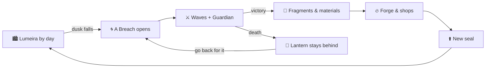

<div align="center">


# Véspera

**A 2D pixel-art action RPG. Every dusk, Breaches open across Lumeira. Someone has to close them.**

[](https://github.com/NasckDev/vespera/actions/workflows/ci.yml)
[](https://github.com/NasckDev/vespera/actions/workflows/release.yml)
[](https://godotengine.org)
[](LICENSE)
[](LICENSE-ASSETS.md)

[**⬇️ Download**](#️-download-and-play) · [**🛠️ Build from source**](#️-build-from-source) · [**🤝 Contribute**](CONTRIBUTING.md) · [🇧🇷 Português](README.md)

</div>

---

## 🏮 What is it

Twenty years ago the sun set over Lumeira and didn't come back for a whole year: **the Year Without Dawn**. That's when the first
**Breaches** opened, rifts into the **Underside**, an inverted Lumeira made of everything the city lost. You arrive with an E seal
burned into your wrist and an old lantern inherited from someone you never met.

> **Stardew Valley** looks · **Dauntless** combat · **Solo Leveling** progression.

- **No fixed class**: Blade, Bow, Staff, Hammer or Daggers define how you fight.
- **Breakable monster parts** drop better materials for the forge.
- **The Lantern**: die in a Breach and your loot stays there until you come back for it.
- **10 hunter seals**, from E to **Alvor**, the rank said to bring the sun back.
- Hand-painted maps with **collision masks**: you walk exactly where the art allows.



## 🚦 Status

🚧 **Under active development** towards v0.1. A playable HTML reference prototype is being ported to Godot.
See the [CHANGELOG](docs/design/CHANGELOG.md). Design docs are written in Brazilian Portuguese; code is in English.

## ⬇️ Download and play

Grab the [**latest release**](https://github.com/NasckDev/vespera/releases/latest) for Windows (installer or zip), Linux or macOS.
Builds from `main` are available as *Artifacts* on the latest green [Release run](https://github.com/NasckDev/vespera/actions/workflows/release.yml).

| Action | Keyboard & mouse | Gamepad |
|---|---|---|
| Move | `WASD` / arrows | left stick / d-pad |
| Attack / Heavy | `J` · `K` / mouse buttons | `X` · `Y` |
| Dodge | `Space` / `Shift` | `B` |
| Interact | `E` | `A` |
| Lantern | `F` | `RB` |
| Pause | `Esc` | `Start` |

## 🛠️ Build from source

```bash
# Requirements: .NET 8+ SDK, Godot 4.7.2 .NET, Git LFS
git clone https://github.com/NasckDev/vespera.git && cd vespera
git lfs pull
dotnet build Vespera.sln
dotnet test tests/Vespera.Tests.csproj
$GODOT --path .                               # play
$GODOT --headless --path . -- --smoke-test    # automated playtest
```

## 🤝 Contributing

Code, art, maps, sound, writing and tests are all welcome. Read [CONTRIBUTING.md](CONTRIBUTING.md) (Portuguese, but PRs in English are fine)
and join the [Discussions](https://github.com/NasckDev/vespera/discussions).

## 📜 License

Code: [MIT](LICENSE) · Art, maps, audio, lore and brand: [CC BY-NC-SA 4.0](LICENSE-ASSETS.md) · Fonts: SIL OFL 1.1.
