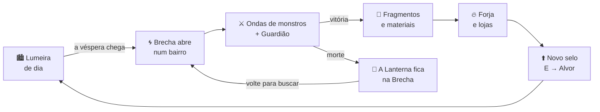
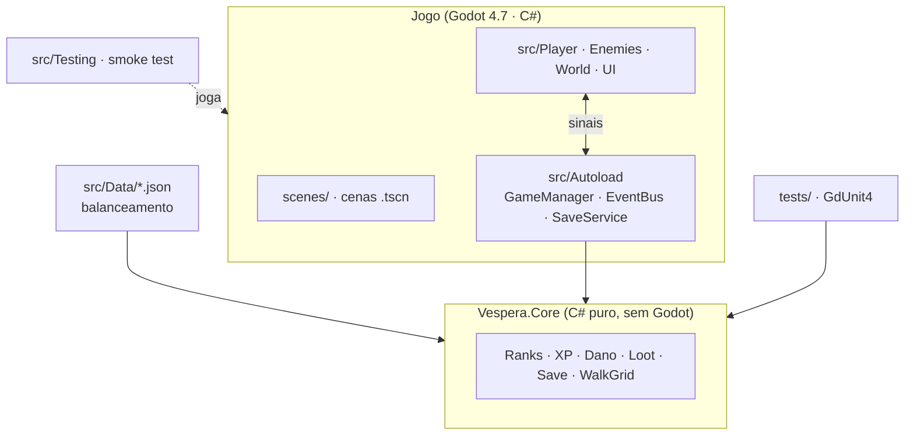

<div align="center">


# Véspera

**RPG de ação 2D em pixel art. Toda véspera, Brechas se abrem em Lumeira. Alguém precisa fechá-las.**

[](https://github.com/NasckDev/vespera/actions/workflows/ci.yml)
[](https://github.com/NasckDev/vespera/actions/workflows/release.yml)
[](https://godotengine.org)
[](https://dotnet.microsoft.com)
[](LICENSE)
[](LICENSE-ASSETS.md)

[**⬇️ Baixar**](#️-baixar-e-jogar) · [**🎮 Como jogar**](#-como-jogar) · [**🛠️ Rodar o código**](#️-rodar-o-código-em-5-minutos) · [**🤝 Contribuir**](CONTRIBUTING.md) · [**📖 GDD**](docs/design/GDD.md) · [🇺🇸 English](README.en.md)

</div>

---

## 🏮 O que é

Há vinte anos o sol se pôs sobre Lumeira e não voltou por um ano inteiro: **o Ano Sem Alvor**. Foi quando as primeiras
**Brechas** se abriram, rasgos que dão para o **Avesso**, uma Lumeira invertida feita de tudo que a cidade perdeu.
Você chega com um selo E queimado no pulso e uma lanterna velha herdada de alguém que não conheceu.

> Visual de **Stardew Valley** · combate de **Dauntless** · progressão de **Solo Leveling**.

<table>
<tr>
<td width="50%"></td>
<td>

**Sem classe fixa.** Você é o que você empunha:

| Arma | Estilo |
|---|---|
| 🗡️ Lâmina | equilibrada, combo de 3 golpes |
| 🏹 Arco | carrega o tiro, perfura |
| 🔮 Cajado | orbe teleguiado de âmbar |
| 🔨 Martelo | lento, quebra partes |
| 🗡️🗡️ Adagas | rápidas, dano pelas costas |

Quebre partes dos monstros para materiais melhores, forje com os Fragmentos e suba de **selo**.

</td>
</tr>
</table>

## 🔁 O loop



<details>
<summary><b>🔰 Os 10 selos de caçador</b> (clique para abrir)</summary>
<br>

| Selo | | Selo | |
|:---:|---|:---:|---|
|  | **E**: recém-chegado |  | **S**: veterano |
|  | **D** |  | **SS** |
|  | **C** |  | **SSS** |
|  | **B** | **SSSS** | começa a *ouvir* as Brechas |
|  | **A** |  | **Alvor**: dizem que traz o sol de volta |

Cada selo aumenta o HP máximo e libera Brechas mais perigosas. O **Nível** sobe à parte, com a experiência.
</details>

<details>
<summary><b>🗺️ Lugares de Lumeira</b></summary>
<br>

Rua da Forja · Guilda da Lanterna · Estalagem · Câmara do Núcleo · Armaria · Magia · Alquimia · Relíquias, e as Brechas
do **Mercado das Marés**, do **Cemitério das Lanternas**, das **Minas**, da **Estufa** e da **Catedral**.
Todos os mapas são pinturas com **máscara de colisão**: você anda exatamente onde o desenho permite.
</details>

## 🚦 Estado do projeto

> 🚧 **Em desenvolvimento ativo** rumo à v0.1. O protótipo jogável de referência (HTML) está sendo portado para Godot.

| Área | Estado |
|---|---|
| Projeto Godot 4.7 .NET, CI, release Windows/Linux/macOS, instalador | ✅ |
| Núcleo testado (ranks, XP, dano, save, colisão por máscara) | ✅ |
| Playtest automático (`--smoke-test`) no CI | ✅ |
| Dados da v2 (armas, 49 materiais, 24 monstros, lojas, NPCs) | 🚧 |
| Mapas da v2, transições, câmera, atlas de sprites | 🚧 |
| Combate (5 armas, esquiva, partes quebráveis, Guardiões) | 🚧 |
| Cidade viva (NPCs, véspera, luzes, estações) | 🚧 |
| Interface (título, HUD, diálogo, forja, lojas, inventário) | 🚧 |

Acompanhe o [CHANGELOG](docs/design/CHANGELOG.md) e as [decisões](docs/design/DECISIONS.md).

## ⬇️ Baixar e jogar

| Plataforma | Download |
|---|---|
| 🪟 Windows (instalador ou zip) | [Última release](https://github.com/NasckDev/vespera/releases/latest) |
| 🐧 Linux (x86_64) | [Última release](https://github.com/NasckDev/vespera/releases/latest) |
| 🍎 macOS (universal) | [Última release](https://github.com/NasckDev/vespera/releases/latest) |

<details>
<summary>Build mais recente do <code>main</code> (antes de virar release)</summary>
<br>

Cada push no `main` gera builds das três plataformas: abra o último run verde de
[**Release**](https://github.com/NasckDev/vespera/actions/workflows/release.yml) e baixe em *Artifacts* (precisa estar logado no GitHub).
</details>

<details>
<summary>macOS: "o app não pode ser aberto"</summary>
<br>

O build é assinado *ad-hoc* (sem conta Apple paga). Clique com o botão direito em **Véspera.app → Abrir** na primeira vez,
ou rode `xattr -dr com.apple.quarantine Véspera.app`.
</details>

<details>
<summary>Windows: o zip tem um <code>.exe</code> e uma pasta <code>data_…</code></summary>
<br>

Mantenha os dois juntos: a pasta tem o runtime .NET do jogo. O instalador faz isso por você.
</details>

## 🎮 Como jogar

| Ação | Teclado e mouse | Gamepad |
|---|---|---|
| Mover | `WASD` / setas | analógico esquerdo / direcional |
| Ataque | `J` / clique esquerdo | `X` / `□` |
| Ataque pesado | `K` / clique direito | `Y` / `△` |
| Esquiva | `Espaço` / `Shift` | `B` / `○` |
| Interagir | `E` | `A` / `✕` |
| Lanterna | `F` | `RB` / `R1` |
| Pausa | `Esc` | `Start` |

## 🛠️ Rodar o código em 5 minutos

```bash
# 1. Pré-requisitos
#    - .NET 8 SDK (ou mais novo) → https://dotnet.microsoft.com/download
#    - Godot 4.7.2 .NET (não a versão padrão) → https://godotengine.org/download
#    - Git + Git LFS (git lfs install)

# 2. Clonar
git clone https://github.com/NasckDev/vespera.git && cd vespera
git lfs pull

# 3. Compilar e testar
dotnet build Vespera.sln
dotnet test tests/Vespera.Tests.csproj

# 4. Abrir no Godot: Import → project.godot → Build (martelo) → Play (F5)
#    Ou pela linha de comando (GODOT = caminho do Godot .NET):
$GODOT --path . --editor      # editor
$GODOT --path .               # jogo
$GODOT --headless --path . -- --smoke-test   # playtest automático
```

Atalhos: `tools/run.ps1` / `tools/run.sh` (build + jogar, `-Smoke`/`--smoke`), `tools/export.sh` (exporta para `build/`).

<details>
<summary><b>🧱 Arquitetura</b></summary>
<br>



- **`src/Core`** é lógica pura, testável sem a engine e reaproveitável no servidor da fase online.
- Sistemas conversam pelo **`EventBus`**; ninguém procura nós pela árvore.
- Mapas são **pinturas + máscara**: a colisão é gerada da máscara e mesclada em poucos retângulos.

Detalhes: [`CLAUDE.md`](CLAUDE.md) · [`DECISIONS.md`](docs/design/DECISIONS.md) · specs do protótipo em [`docs/design/prototype-v2/`](docs/design/prototype-v2/).
</details>

<details>
<summary><b>📁 Estrutura do repositório</b></summary>
<br>

```
assets/      arte, mapas, áudio e fontes (Git LFS)
docs/        GDD, decisões, specs do protótipo, marca
scenes/      cenas Godot
src/         todo o C# (Core puro + nós Godot)
tests/       testes GdUnit4 do Core
tools/       scripts de run/export/labels
installer/   instalador Windows (Inno Setup)
```
</details>

## 🤝 Contribuir

Pull requests são muito bem-vindos: código, arte, mapas, som, texto e testes.
Comece pelo [**CONTRIBUTING.md**](CONTRIBUTING.md) e procure issues com
[`good first issue`](https://github.com/NasckDev/vespera/labels/good%20first%20issue).
Dúvidas e ideias: [Discussions](https://github.com/NasckDev/vespera/discussions).

## 📜 Licença

- **Código:** [MIT](LICENSE).
- **Arte, mapas, áudio, lore e marca:** [CC BY-NC-SA 4.0](LICENSE-ASSETS.md). Pode remixar com crédito, sem uso comercial.
- **Fontes:** Pixelify Sans, VT323 e Cinzel, sob SIL OFL 1.1.

<div align="center">
<sub>Feito com 🏮 em Lumeira. Mantenha as lanternas acesas.</sub>
</div>
