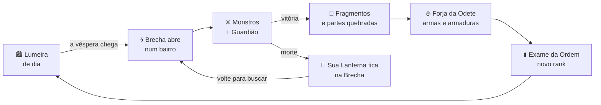
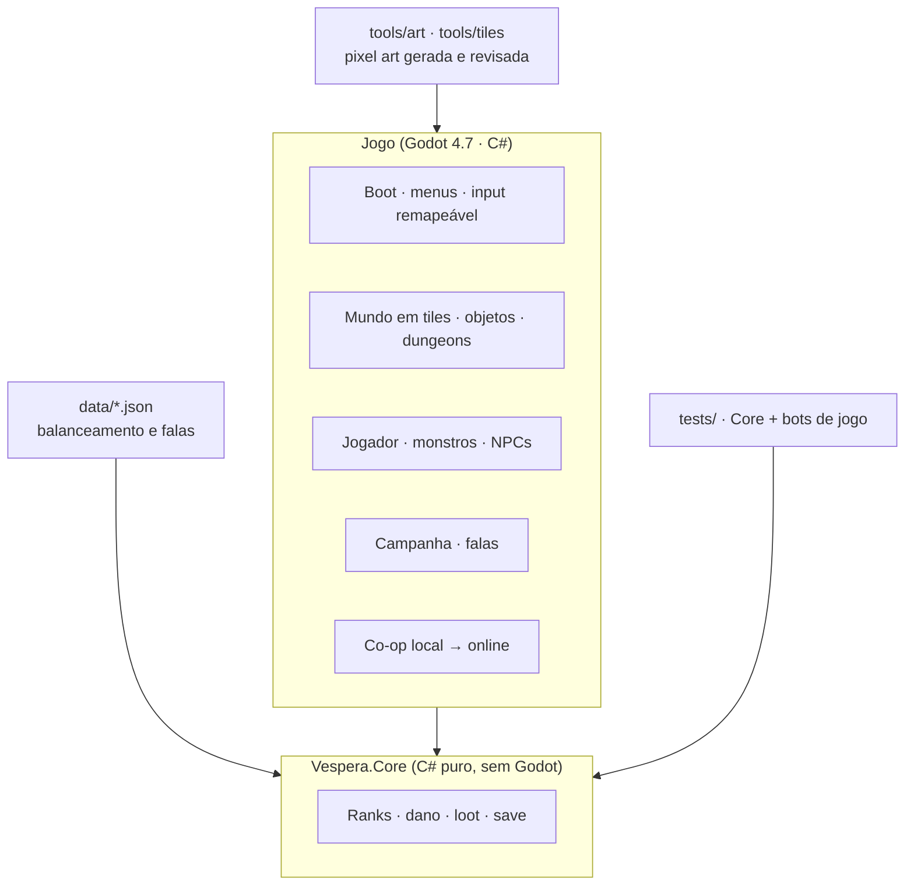

<div align="center">


# Véspera

**RPG de ação 2D em pixel art para desktop. Toda véspera, Brechas se abrem em Lumeira. Alguém precisa fechá-las.**

[](https://github.com/NasckDev/vespera/actions/workflows/ci.yml)
[](https://godotengine.org)
[](https://dotnet.microsoft.com)
[](#-uma-nova-versão-está-chegando)
[](LICENSE)
[](LICENSE-ASSETS.md)

[**🌅 Nova versão**](#-uma-nova-versão-está-chegando) · [**🏮 O jogo**](#-o-que-é) · [**🗺️ Roteiro**](#️-roteiro-da-v2) · [**🛠️ Rodar o código**](#️-rodar-o-código) · [**🤝 Contribuir**](CONTRIBUTING.md) · [**📖 GDD**](docs/design/GDD.md) · [🇺🇸 English](README.en.md)

</div>

---

## 🌅 Uma nova versão está chegando

> **O Véspera está sendo reconstruído do zero.** A próxima versão, a **v2**, será a **beta pública** do jogo.

Jogamos a v0.1 de ponta a ponta e fomos honestos: os sistemas funcionavam, mas o jogo não estava à altura da ideia.
Os personagens pareciam imagens deslizando, os mapas deixavam o jogador atravessar paredes, a arte misturava estilos
e a história do Ano Sem Alvor quase não aparecia. Em vez de remendar, decidimos recomeçar com uma base sólida.

**O que muda na v2:**

| Na v0.1 | Na v2 |
|---|---|
| Mapas pintados com uma máscara de colisão à parte, que permitia atravessar paredes | Mundo em **tiles 16×16**: a colisão vem do próprio chão e das paredes |
| Uma pose parada por direção, "deslizando" pela tela | **Animação quadro a quadro** em 4 direções: andar, esquiva, combo, golpe pesado, habilidade, dano e morte |
| O personagem igual do selo E ao S | **5 estágios visuais** por classe: aprendiz → caçador → veterano → elite → radiante |
| Estilos misturados (pintura em alta resolução, chibi, ícones simples) | **Uma grade de pixel, uma paleta**, pixel art feita para o jogo, nítida em qualquer monitor |
| História seguindo um protótipo | Campanha completa do [GDD](docs/design/GDD.md): os Guardiões, os segredos dos moradores, o Reflexo e o Alvor |
| Só um jogador | **Modo história solo** e **co-op**, primeiro local (2 jogadores no mesmo PC), depois online (2 a 4) |

A v2 é construída **em camadas**: cada uma só começa depois que a anterior foi jogada, testada e aprovada.
O plano completo está em [`docs/v2/PLANO-V2.md`](https://github.com/NasckDev/vespera/blob/v2/docs/v2/PLANO-V2.md) (branch [`v2`](https://github.com/NasckDev/vespera/tree/v2)).
A v0.1 continua disponível, congelada na tag [`v0.1-final`](https://github.com/NasckDev/vespera/tree/v0.1-final).

## 🏮 O que é

Há vinte anos o sol se pôs sobre Lumeira e não voltou por um ano inteiro: **o Ano Sem Alvor**. Foi quando as primeiras
**Brechas** se abriram, rasgos que dão para o **Avesso**, uma Lumeira invertida feita de tudo que a cidade perdeu,
esqueceu ou enterrou. O que vive lá não é exatamente monstro: é **eco** de coisas que já foram.

A cidade sobreviveu porque manteve as lanternas acesas. Quem entra nas Brechas para buscar **Fragmentos** virou
**caçador**; quem organiza os caçadores é a **Ordem da Lanterna**. E diz a lenda que quem chegar ao rank **Alvor**
pode fazer o sol voltar de vez. Ninguém nunca chegou.

Você chega com um **selo E** queimado no pulso e uma **lanterna velha** herdada de alguém que não conheceu.

> Cidade viva na linha de **Stardew Valley** · caçada de partes na linha de **Monster Hunter / Dauntless** ·
> portais por rank na linha de **Solo Leveling** · combate de leitura na linha de **Hades** e **Death's Door**.

### Os temas
- **Luz contra esquecimento.** Cada monstro é algo que alguém deixou para trás.
- **Comunidade.** Você não é um herói solitário: é a razão de a padaria abrir amanhã.
- **Subir é um fardo.** Cada rank marca a pele e aproxima o caçador do Avesso.

## 🔁 O loop



## 🎮 Modos de jogo

| Modo | O que é | Quando |
|---|---|---|
| 📖 **História** | Campanha solo da chegada a Lumeira até o Alvor | beta v2 |
| 👥 **Co-op local** | 2 jogadores no mesmo PC (teclado + gamepad ou 2 gamepads), câmera compartilhada | beta v2 |
| 🌐 **Co-op online** | 2 a 4 caçadores, um jogador hospeda; loot individual, Lanterna recuperável pelos amigos | depois da beta |

Menu completo desde a primeira tela: nova história, continuar, opções (som, vídeo, tremor de tela, reduzir flashes,
tamanho do texto), **controles remapeáveis** (teclado, mouse e gamepad) e **ajuda / como jogar**.

## ⚔️ Classes

Na beta entram três classes, cada uma com ritmo próprio, uma habilidade nova a cada estágio e armas que mudam de visual
conforme são forjadas:

| Classe | Estilo | Evolução |
|---|---|---|
| 🗡️ **Lâmina** | equilibrada, combo de 3 golpes e corte giratório | investida → aparar → lâmina de luz → corte duplo → *Lâmina de Duas Vésperas* |
| 🏹 **Arco** | longo alcance, flecha carregada que perfura | rolar e atirar → flecha de luz → chuva de flechas → marca do caçador → *feixe do Alvor* |
| 🔨 **Martelo** | lento e pesado, quebra partes em dobro | tremor → escudo de bronze → martelada de âmbar → onda sísmica → *queda do sino* |

🔮 **Cajado** e 🗡️🗡️ **Adagas** chegam logo depois da beta.

## 🔰 Ranks de caçador

| | Rank | | Rank |
|:---:|---|:---:|---|
|  | **E**, recém-chegado |  | **S** |
|  | **D** |  | **SS** |
|  | **C**, primeiro exame da Ordem |  | **SSS**, poucos chegam aqui |
|  | **B** |  | **Alvor**, para muitos, impossível |
|  | **A** | | |

**Dificuldade que faz sentido:** uma Brecha de rank D tem monstros de rank D e solta loot D, e de vez em quando
algo do rank acima. Cada Brecha mostra o **poder recomendado**. Subir de rank exige experiência **e** conquista:
derrotar o Guardião daquele rank e passar nos **exames da Ordem** (C, A, S e SSS). Monstros de rank alto não
ganham só vida: ganham padrões novos.

**Morrer não apaga seu progresso:** os Fragmentos daquela caçada ficam na sua **Lanterna**, dentro da Brecha, até você
voltar para buscar. Seu equipamento nunca se perde.

## 📖 A campanha (Parte 1)

| Ato | Rank | Onde | Guardião |
|---|---|---|---|
| Prólogo | E | Praça da Lanterna | — |
| I | E | Bairro das Forjas → *Esgotos do Mercado* | **Lodo-Mãe** |
| II | D | Pomar Alto → *Pomar Podre* | **A Macieira Oca** |
| III | C | Mercado das Marés → *Cais Afogado* | **O Farol Afogado** |
| IV | B | Cemitério das Lanternas | **A Velória** |
| V | A | Torre do Sino → *Torre do Sino Mudo* | **O Sineiro Mudo** |
| VI | S | Ruas Baixas → *Ruas Invertidas* | **O Inquilino** |
| VII | SS–SSS | o Avesso profundo | ecos dos Guardiões |
| Final | Alvor | a primeira Brecha da Praça | **O Reflexo**, você mesmo, que aprendeu a lutar como você |

Pelo caminho: **Odete**, a ferreira que nunca elogia; **Mestre Benício**, que tocou o sino pela última vez;
**Tia Nilza** e sua taverna; **Ravi**, o rival que sobe junto com você; **Lis**, a menina que sabe onde a Brecha
vai abrir; **Dona Celeste**, a herbalista; **Capitão Severo**, o último pescador da névoa; e **o Vigia**, que só
aparece ao anoitecer. Cada um guarda um segredo ligado ao Ano Sem Alvor.

Vencer o Reflexo encerra a **Parte 1**. A história continua na **Parte 2**.

## 🗺️ Roteiro da v2

| # | Camada | Estado |
|---|---|---|
| A | Pipeline de pixel art (personagem animado de verdade + tilesets) | 🚧 em andamento |
| 0 | Fundação: título, opções, controles, ajuda, pausa, save | 🚧 em andamento |
| 1 | Piso: cidade e Brecha em tiles, colisão sem atravessar paredes | ⏳ |
| 2 | Objetos: lampiões, baús, portas, barracas, com profundidade e interação | ⏳ |
| 3 | Dungeons: Brechas por rank e por bairro | ⏳ |
| 4 | Monstros: um comportamento claro por monstro, partes quebráveis, loot por rank | ⏳ |
| 5 | NPCs da cidade e suas funções | ⏳ |
| 6 | Falas e campanha completa | ⏳ |
| 7 | Lâmina, Arco e Martelo com os 5 estágios de evolução | ⏳ |
| 8 | Co-op local, depois online | ⏳ |
| 9 | **Beta pública**: balanceamento, acessibilidade, instalador | ⏳ |

Cada camada só é dada como pronta depois de testes automáticos **e** de uma rodada de testes jogando de verdade.

## 🛠️ Rodar o código

```bash
# Pré-requisitos: .NET 8 SDK, Godot 4.7.2 .NET (não a versão padrão), Git + Git LFS
git clone https://github.com/NasckDev/vespera.git && cd vespera
git lfs pull

# v2 em construção
git switch v2

# ou a v0.1 congelada
git switch --detach v0.1-final

dotnet build Vespera.sln
$GODOT --path . --editor     # abre no editor (GODOT = caminho do Godot .NET)
$GODOT --path .              # roda o jogo
```

<details>
<summary><b>🧱 Arquitetura da v2</b></summary>
<br>



- **`src/Core`** é lógica pura, testada sem a engine e reaproveitável no servidor do online.
- O jogador é dirigido por uma "fonte de input" (teclado, gamepad ou rede), então o co-op entra sem refazer nada.
- Um bot de testes tenta atravessar cada parede de cada mapa: se conseguir, o build falha.
</details>

## 🤝 Contribuir

Pull requests são bem-vindos: código, pixel art, mapas, som, texto e testes. Leia o [CONTRIBUTING.md](CONTRIBUTING.md)
e o [plano da v2](https://github.com/NasckDev/vespera/blob/v2/docs/v2/PLANO-V2.md) antes de começar: ele define a grade,
a paleta e o padrão de animação que toda contribuição precisa seguir.
Dúvidas e ideias: [Discussions](https://github.com/NasckDev/vespera/discussions).

## 📜 Licença

- **Código:** [MIT](LICENSE).
- **Arte, mapas, áudio, lore e marca:** [CC BY-NC-SA 4.0](LICENSE-ASSETS.md). Pode remixar com crédito, sem uso comercial.
- **Fontes:** Pixelify Sans, VT323 e Cinzel, sob SIL OFL 1.1.

<div align="center">
<sub>Feito com 🏮 em Lumeira. Mantenha as lanternas acesas.</sub>
</div>
